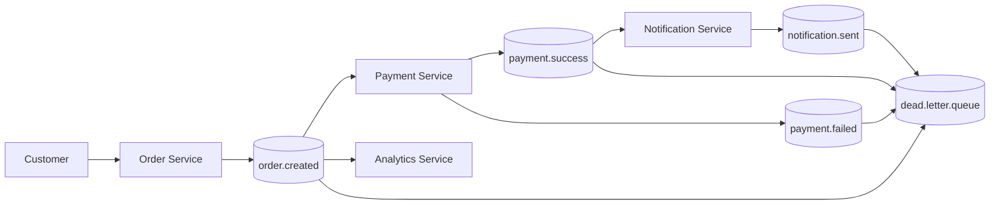
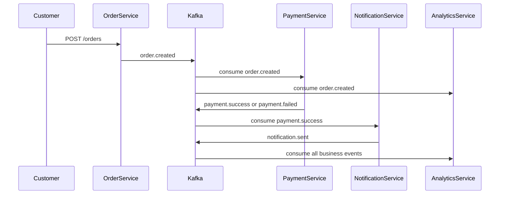

# EventFlow

EventFlow is a production-style event-driven e-commerce backend built with FastAPI, Apache Kafka, PostgreSQL, SQLAlchemy, Docker, and Docker Compose. It demonstrates independent microservices, consumer groups, idempotent processing, manual offset commits, retry handling, and dead-letter queue routing.

## Architecture



## Kafka Flow



## Services

- Order Service: REST API, persists orders, publishes `order.created`.
- Payment Service: consumes `order.created`, simulates payment processing, persists payments, publishes `payment.success` or `payment.failed`.
- Notification Service: consumes `payment.success`, persists notification logs, publishes `notification.sent`.
- Analytics Service: consumes all business events and maintains a PostgreSQL projection with total orders, total revenue, and payment success rate.

## Setup

1. Copy `.env.example` to `.env` and adjust values if needed.
2. Start the stack with `docker compose up --build`.
3. Order API: `POST http://localhost:8000/orders`.
4. Health endpoints: `/health` on each service.
5. Metrics endpoints: `/metrics` on each service.

## Troubleshooting

If `docker compose up --build` fails while pulling images with an error like `failed to fetch oauth token` or `http: server gave HTTP response to HTTPS client`, the issue is usually Docker Desktop proxy configuration rather than this repository.

On Windows, check the daemon proxy settings with:

```powershell
docker info --format "HTTPProxy={{.HTTPProxy}} HTTPSProxy={{.HTTPSProxy}} NoProxy={{.NoProxy}}"
```

If Docker is using a proxy such as `http.docker.internal:3128`, either disable the proxy in Docker Desktop or set the correct HTTP/HTTPS proxy values for your network. After changing the setting, retry the compose command.

Example order payload:

```json
{
  "customer_name": "Yash",
  "product_name": "Laptop",
  "amount": 50000
}
```

## API Documentation

- `POST /orders` creates a new order and emits `order.created`.
- `GET /orders/{order_id}` retrieves an order.
- `GET /health` checks service readiness.
- `GET /metrics` exposes Prometheus metrics.

## Scaling Strategy

Kafka consumer groups let each service scale horizontally without duplicating work within the same group. You can increase payment, notification, or analytics replicas independently, and Kafka will partition assignments across the group. Order Service scales as a stateless API tier, while PostgreSQL can be scaled with read replicas, connection pooling, and a transactional outbox if you later want stricter publish guarantees.

## Consumer Groups

- Payment Service: `payment-service-group`
- Notification Service: `notification-service-group`
- Analytics Service: `analytics-service-group`

Each service commits offsets manually only after processing succeeds, which prevents message loss and supports deterministic replay.

## Fault Tolerance

- Manual offset commits prevent acknowledging work before it is complete.
- Retry attempts are capped at 3 for each message.
- Failed messages are routed to `dead.letter.queue` with the original payload and error context.
- Idempotency is enforced with the `processed_events` table.
- Kafka producers use idempotent delivery settings.

## Observability

- Structured JSON logs with request and correlation IDs.
- `/health` endpoints for liveness/readiness checks.
- `/metrics` endpoints for Prometheus scraping.
- `monitoring/prometheus.yml` and `docker-compose.yml` include a ready-to-run Prometheus scrape setup.
- Redis powers the shared API rate limiter and is available for cache-backed workflows.
- The DLQ debugger can be launched with `python -m shared.kafka.dlq_consumer`.

## Future Improvements

- Transactional outbox for exact-once publish semantics from Order Service.
- Prometheus and Grafana deployment manifests.
- Kubernetes HPA and ingress manifests.
- Distributed tracing with OpenTelemetry.
- Schema registry and event versioning.
