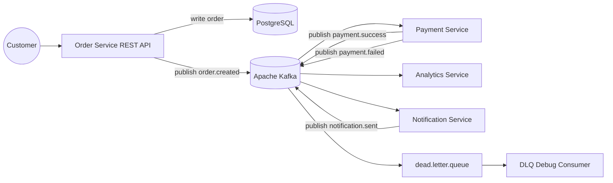

# EventFlow Architecture

The system uses Kafka as the event backbone and PostgreSQL as the source of truth for service-local state and analytics projections. Each consumer group is isolated, which allows independent scaling and replay without coupling services together.
